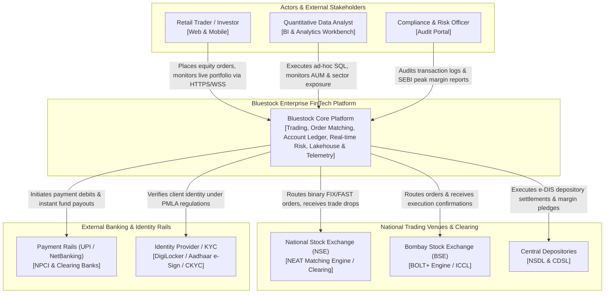
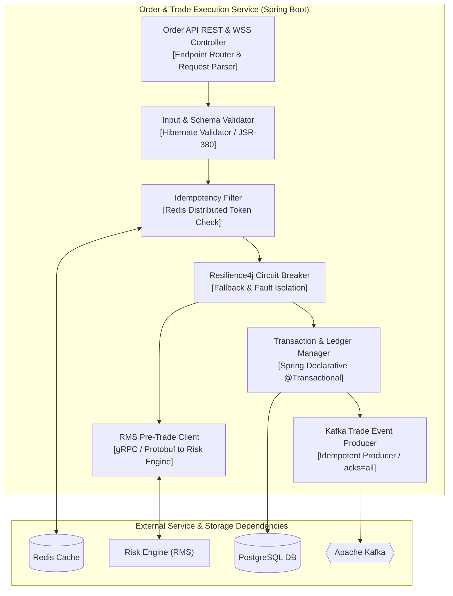

# Enterprise FinTech Architecture & Distributed Systems Specification

**Document Reference:** `4_Software_Architecture_Diagram.md`  
**System Classification:** High-Throughput Event-Driven Trading & Analytics Architecture  
**Architectural Framework:** C4 Model (Context, Containers, Components, Dynamic Sequences)  

---

## 1. C4 Architecture Level 1: System Context Diagram

The System Context diagram establishes the boundaries of the Bluestock FinTech Platform, illustrating interactions with retail traders, institutional analysts, external clearinghouses, national stock exchanges, and banking payment rails:



---

## 2. C4 Architecture Level 2: Container Diagram

The Container diagram decomposes the Bluestock Platform into discrete runtime execution environments, data stores, streaming message buses, and transformation microservices:

```mermaid
graph TB
    subgraph Client_Applications ["Client Presentation Containers"]
        SPA["Single Page App (SPA)<br/>[React / TypeScript / Next.js]"]
        MOBILE["Mobile App<br/>[React Native / Flutter]"]
    end

    subgraph Edge_Infrastructure ["Edge & Ingress Routing"]
        CDN["Cloudflare Edge CDN<br/>[Static Assets & WAF Protection]"]
        LB["High-Availability Load Balancer<br/>[AWS ALB / Envoy Proxy]"]
        GW["API Gateway & Reverse Proxy<br/>[Kong / NGINX / Rate Limiter]"]
    end

    subgraph Identity_Container ["Identity & Security"]
        AUTH_SVC["Auth & Identity Service<br/>[OAuth 2.0 / OIDC / RS256 JWT]"]
    end

    subgraph Application_Microservices ["Backend Microservice Containers"]
        MKT_SVC["Market Data Ticker Service<br/>[Go / Gorilla WebSocket]"]
        ORD_SVC["Order & Trade Execution Service<br/>[Java 21 / Spring Boot 3]"]
        RMS_SVC["Real-Time Risk Management (RMS)<br/>[Rust / Actix-web]"]
        USER_SVC["User & Portfolio Account Service<br/>[Python / FastAPI / Pydantic]"]
    end

    subgraph Operational_Data_Stores ["Transactional Storage (OLTP)"]
        REDIS[("Redis In-Memory Cluster<br/>[Market Depth, L2 Cache, Rate Limits]")]
        POSTGRES_MASTER[("PostgreSQL 16 Primary<br/>[ACID Orders, Trades, User Ledgers]")]
        POSTGRES_SLAVE[("PostgreSQL 16 Read Replicas<br/>[High-Throughput Read Scaling]")]
    end

    subgraph Event_Streaming_Decoupling ["Event Streaming & CDC"]
        DEBEZIUM["Debezium CDC Connector<br/>[WAL Log Scraper]"]
        KAFKA{{"Apache Kafka Event Bus<br/>[Topics: orders, trades, telemetry, ledger]"}}
    end

    subgraph Analytics_Lakehouse ["Analytical Lakehouse (OLAP)"]
        AIRFLOW["Apache Airflow / Dagster<br/>[Pipeline Orchestrator]"]
        DBT["dbt Core Transformation Engine<br/>[Medallion: Bronze -> Silver -> Gold]"]
        LAKEHOUSE[("Enterprise Data Warehouse<br/>[Snowflake / BigQuery / DuckDB]")]
    end

    subgraph Analytics_BI_Containers ["Analytics & Consumption"]
        SUPERSET["Apache Superset / Tableau<br/>[Executive BI & Operational Dashboards]"]
        JUPYTER["Data Analyst Workbench<br/>[Python / Pandas / Jupyter Hub]"]
    end

    %% Network links
    SPA -->|HTTPS / WSS| CDN
    MOBILE -->|HTTPS / WSS| CDN
    CDN --> LB
    LB --> GW
    GW <--> AUTH_SVC
    GW --> MKT_SVC
    GW --> ORD_SVC
    GW --> RMS_SVC
    GW --> USER_SVC

    MKT_SVC <--> REDIS
    ORD_SVC <--> RMS_SVC
    ORD_SVC --> POSTGRES_MASTER
    USER_SVC --> POSTGRES_MASTER
    POSTGRES_MASTER -.->|Physical Streaming Replication| POSTGRES_SLAVE
    USER_SVC <--> POSTGRES_SLAVE

    POSTGRES_MASTER -->|Write-Ahead Log (WAL)| DEBEZIUM
    DEBEZIUM -->|Stream JSON Events| KAFKA
    ORD_SVC -.->|Domain Event Pub| KAFKA

    KAFKA --> DBT
    AIRFLOW --> DBT
    DBT --> LAKEHOUSE

    LAKEHOUSE --> SUPERSET
    LAKEHOUSE --> JUPYTER
```

---

## 3. C4 Architecture Level 3: Component Diagram (Order & Execution Service)

The Component diagram details the internal software architecture of the mission-critical **Order & Trade Execution Service**:



---

## 4. End-to-End Dynamic Interaction Sequence Diagram

The following sequence diagram details an end-to-end stock order transaction, showing microsecond/millisecond latency bounds, database row locking, event-driven CDC decoupling, dbt batch transformation, and analytical dashboard visualization:

```mermaid
sequenceDiagram
    autonumber
    actor Trader as Retail Trader (Web Client)
    participant WAF as WAF / Cloudflare CDN
    participant Gateway as API Gateway (Kong / NGINX)
    participant Auth as Identity Provider (Auth0 / OIDC)
    participant OrderSvc as Order Service (Java / Spring)
    participant RiskSvc as Pre-Trade RMS (Rust / gRPC)
    participant Database as OLTP DB (PostgreSQL 16)
    participant Kafka as Event Bus (Apache Kafka)
    participant ETL as Orchestrator & dbt (Airflow)
    participant DW as Lakehouse (Snowflake / BigQuery)
    participant BI as Analytics Dashboard (Apache Superset)
    actor Analyst as Data Analyst / Portfolio Manager

    %% 1. Ingress & Security
    Trader->>WAF: 1. POST /api/v1/orders (Payload + Idempotency-Key: uuid)
    Note over Trader,WAF: Latency: ~15-30ms (Edge Network Transit)
    WAF->>Gateway: 2. Inspect DDoS, rate-limit, and forward request
    Gateway->>Auth: 3. Verify RS256 JWT Token & Claims (Scope: trade:write)
    Auth-->>Gateway: 4. Token valid (UserId: 8492, KYC: Level 3)
    Gateway->>OrderSvc: 5. Route request with X-Correlation-ID header

    %% 2. Pre-Trade Risk Verification
    OrderSvc->>RiskSvc: 6. gRPC CheckMarginAndExposure(UserId: 8492, Symbol: RELIANCE, Qty: 100)
    Note over OrderSvc,RiskSvc: In-memory evaluation: < 2ms latency
    RiskSvc-->>OrderSvc: 7. Margin Approved (Required: ₹2,97,000 | Available: ₹3,50,000)

    %% 3. ACID Persistence
    Note over OrderSvc,Database: ACID Transaction Boundary (@Transactional)
    OrderSvc->>Database: 8. BEGIN TRANSACTION
    OrderSvc->>Database: 9. SELECT cash_balance FROM accounts WHERE user_id = 8492 FOR UPDATE
    OrderSvc->>Database: 10. INSERT INTO orders (order_id, user_id, symbol, qty, price, status) VALUES (...)
    OrderSvc->>Database: 11. UPDATE accounts SET cash_balance = cash_balance - 297000 WHERE user_id = 8492
    OrderSvc->>Database: 12. COMMIT TRANSACTION
    Database-->>OrderSvc: 13. Transaction Committed (TxID: 981240, Latency: ~4ms)

    OrderSvc->>Gateway: 14. HTTP 201 Created (OrderExecutionReceipt JSON)
    Gateway-->>Trader: 15. Render UI Confirmation Toast & Live Portfolio Refresh

    %% 4. Streaming CDC Ingestion
    Note over Database,Kafka: Asynchronous Decoupled Event Pipeline
    Database->>Kafka: 16. Stream PostgreSQL WAL Record via Debezium CDC (< 100ms lag)
    OrderSvc->>Kafka: 17. Produce Domain Event: OrderExecutedEvent to topic 'trades.v1' (acks=all)

    %% 5. Analytical Transformation (dbt & Airflow)
    Note over Kafka,DW: Micro-Batch / Scheduled Lakehouse Ingestion
    ETL->>Kafka: 18. Ingest micro-batch of trade events (Kafka Consumer)
    ETL->>DW: 19. Stage raw records into Bronze table: 'bronze.stg_trade_events'
    ETL->>ETL: 20. Run dbt model execution (Silver deduplication, Gold aggregate marts)
    ETL->>DW: 21. Materialize Gold Fact Table: 'gold.fact_daily_trading_positions'
    
    %% 6. Analytics & Portfolio Management
    DW->>BI: 22. Invalidate cache & update Semantic Layer Aggregates
    Analyst->>BI: 23. Query AUM, Daily Liquidity Exposure & VaR Concentration
    BI-->>Analyst: 24. Render real-time equity risk waterfall & performance attribution
```



---

## 5. Technical Specifications

### 5.1 Client-Server Protocols & Communication Architecture

1. **HTTP/2 & HTTP/3 Transport**:
   - Deploys binary framing, multiplexed stream channels over a single TCP/QUIC connection, and HPACK header compression.
   - Eliminates head-of-line blocking at the application tier.
2. **WebSocket Full-Duplex Feeds (`wss://`)**:
   - Used for streaming binary Level 2 market depth, order book ticks, and trade execution notices directly to client WebSockets.
   - Avoids repetitive HTTP polling overhead ($<5\text{ms}$ socket push latency).
3. **gRPC East-West Service Communication**:
   - Inter-microservice calls (e.g., Order Service $\rightarrow$ Pre-Trade Risk Engine) operate over gRPC using Protocol Buffers (`proto3`).
   - Binary serialization minimizes CPU parsing overhead by over $70\%$ compared to standard REST/JSON over HTTP/1.1.
4. **Stateless Scalability**:
   - Application servers store zero in-memory session state; horizontal pod autoscaling (Kubernetes HPA) automatically scales worker nodes from 5 to 50 pods during market open volatility surges (09:15–09:45 IST).

---

### 5.2 Authentication, Authorization & Security Architecture

```
  Client Terminal                API Gateway (Kong)               Identity Provider (IdP)
         │                               │                                   │
         │── 1. POST /oauth/token ──────>│──────────────────────────────────>│
         │   (Auth Code + PKCE Verifier) │                                   │
         │                               │                                   │
         │<── 2. Access + Refresh Token ─│<──────────────────────────────────│
         │       (RS256 JWT, 15 min exp) │                                   │
         │                               │                                   │
         │── 3. GET /orders (Bearer JWT)─>│                                   │
         │                               │── 4. Verify RS256 Sig via JWKS ──>│
         │                               │      Validate exp, iss, claims    │
         │                               │                                   │
         │                               │── 5. Forward validated context ──> Core Backend
```

1. **OAuth 2.0 with PKCE (Proof Key for Code Exchange)**:
   - Mandatory authorization framework for single-page applications and mobile terminals, mitigating authorization code injection without storing hardcoded client secrets.
2. **RS256 Asymmetric Cryptographic Signing**:
   - Identity Providers sign access tokens using a **Private RSA Key (2048-bit)**.
   - API Gateways and microservices independently verify cryptographic signatures using the IdP's cached **JSON Web Key Set (JWKS)** public endpoint without requiring network trips per request.
3. **Fine-Grained RBAC & ABAC Enforcement**:
   - **Role-Based Access Control (RBAC)**: Governs baseline capabilities (`ROLE_RETAIL_TRADER`, `ROLE_PORTFOLIO_ANALYST`, `ROLE_COMPLIANCE`).
   - **Attribute-Based Access Control (ABAC)**: Enforces dynamic operational constraints:
     $$\text{Access Granted} \iff (\text{Role} = \text{'Analyst'}) \land (\text{IP} \in \text{Corporate VPN}) \land (\text{Time} \in [08:00, 18:00\text{ IST}])$$
4. **Token Security Lifecycle**:
   - Short-lived Access Tokens (15-minute expiry).
   - Refresh tokens stored in encrypted `HttpOnly`, `SameSite=Strict`, `Secure` cookies with automatic token rotation on every exchange.

---

### 5.3 Structured Logging, Telemetry & Distributed Tracing

Structured JSON log payloads ensure machine-parseability across centralized log aggregators (ELK / Grafana Loki):

```json
{
  "timestamp": "2026-10-18T11:05:12.891Z",
  "level": "INFO",
  "service": "order-execution-service",
  "trace_id": "c4b8e912-32a1-4f90-b184-e910248a7b11",
  "span_id": "a90184b2c8",
  "user_id": 8492,
  "client_ip": "103.21.244.18",
  "event": "ORDER_PLACED",
  "payload": {
    "symbol": "RELIANCE",
    "qty": 100,
    "order_type": "MARKET",
    "executed_price": 2970.00,
    "latency_ms": 14.2
  }
}
```

1. **W3C Distributed Tracing (`traceparent`)**:
   - The edge gateway injects an `X-Correlation-ID` into every incoming request.
   - This unique identifier propagates downstream across HTTP headers, Kafka message headers, and database comment tags (`/* trace_id=... */`), allowing end-to-end waterfall latency tracing in OpenTelemetry / Jaeger.
2. **Log Tiers**:
   - `DEBUG`: Internal execution steps (active in development / staging only).
   - `INFO`: Normal state mutations (order accepted, trade settled, batch model completed).
   - `WARN`: Recoverable operational anomalies (rate-limit backoff engaged, secondary fallback endpoint triggered).
   - `ERROR`: Component-level failures requiring immediate alerting (payment webhook signature failed, database deadlock retried).
   - `FATAL`: Unrecoverable service crashes requiring emergency on-call intervention.

---

### 5.4 Error Contracts & Distributed System Resilience

1. **Standardized RFC 7807 Problem Details Specification**:
   ```json
   {
     "type": "https://api.bluestock.in/errors/insufficient-margin",
     "title": "Pre-Trade Margin Shortfall",
     "status": 422,
     "detail": "Order placement requires ₹2,97,000.00. Current available margin is ₹1,42,500.00.",
     "instance": "/orders/req_c4b8e912",
     "code": "RMS_MARGIN_DEFICIT",
     "timestamp": "2026-10-18T11:05:13Z"
   }
   ```
2. **Exponential Backoff with Full Jitter**:
   $$\text{Backoff Duration} = \text{random}\left(0, \min(M, B \times 2^{\text{attempt}})\right)$$
   *Where $B = 1.5\text{s}$ base, $M = 30\text{s}$ maximum. Full random jitter prevents thundering-herd synchronicity against recovering infrastructure.*
3. **Circuit Breaker State Machine**:
   - Monitors upstream microservice failure rates using a sliding window of 100 requests.
   - If error rate exceeds $50\%$, the circuit transitions from **CLOSED** to **OPEN**, failing fast without exhausting threads and serving cached Level 2 market data.
   - After a 30-second cooldown, transitions to **HALF-OPEN** to test upstream recovery before resuming normal operations.

---

### 5.5 The SDLC Lifecycle from a Data Analyst's Perspective

Data analysts operate as full software engineering stakeholders within modern Medallion data lakehouses:

```
┌──────────────────┐       ┌──────────────────┐       ┌──────────────────┐
│  1. Metric & Spec│       │ 2. Data Contracts│       │ 3. Analytics Eng │
│   Governance     │ ────> │  & Schema Models │ ────> │  (dbt / SQL)     │
└──────────────────┘       └──────────────────┘       └──────────────────┘
                                                               │
┌──────────────────┐       ┌──────────────────┐                │
│ 6. Observability │       │ 5. CI/CD Pipeline│                ▼
│  & Drift Monitor │ <──── │  & Deployment    │ <──── ┌──────────────────┐
└──────────────────┘       └──────────────────┘       │ 4. Quality Gates │
                                                      │  & Reconciliation│
                                                      └──────────────────┘
```

1. **Requirements Governance & Metric Dictionaries**:
   - Formulates single-source-of-truth definitions for core business metrics (e.g., defining *Active Trading Client* as an account executing $\ge 1$ order per rolling 30-day window).
2. **Data Contracts & Schema Mapping**:
   - Formal agreements between transactional engineering teams (OLTP producers) and analytics consumers, preventing unannounced column drops or type mutations from breaking downstream pipelines.
3. **Modular dbt Transformations (Medallion Pattern)**:
   - **Bronze**: Append-only raw ingested events from Kafka/Debezium.
   - **Silver**: Deduplicated, cleaned, type-cast dimensional models with surrogate keys.
   - **Gold**: High-performance aggregate datamarts optimized for sub-second BI query latency.
4. **Automated Quality Testing & Reconciliation**:
   - Automated dbt schema tests (`not_null`, `unique`, `relationships`) executed on pull requests.
   - **Zero-Variance Financial Reconciliation**: Mathematical assertions verifying that aggregate cash ledger debits equal clearinghouse net settlement credits:
     $$\Delta = \left| \sum \text{Ledger Debits} - \sum \text{Settlement Credits} \right| \equiv 0.00$$
5. **CI/CD Pipeline & Orchestration**:
   - Airflow DAGs version-controlled in Git, deploying tested models into production through zero-downtime blue/green table swapping.
6. **Data Observability & Drift Detection**:
   - Automated alerting on data freshness breaches, anomalous row count drops, and distribution drift before executive dashboards reflect corrupted states.
