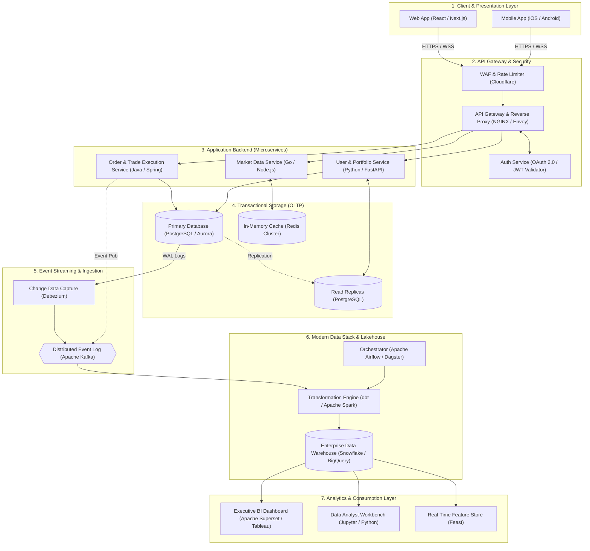
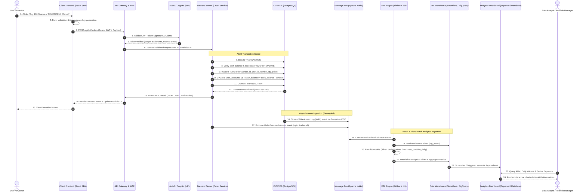

# Software Development & System Architecture Specification

**Document Ref:** `4_Software_Architecture_Diagram.md`  
**Target Architecture:** End-to-End Enterprise FinTech & Analytics Stack  
**System Flow:** User Action $\rightarrow$ REST API Request $\rightarrow$ Backend Server $\rightarrow$ Database Transaction $\rightarrow$ ETL/Data Pipeline $\rightarrow$ Analytics Dashboard  

---

## 1. System Architecture Diagram

The high-level architecture separates low-latency transactional execution (**OLTP**) from high-throughput analytical workloads (**OLAP**) using event-driven decoupling and automated data pipelines:



---

## 2. End-to-End User Interaction Sequence Diagram

The sequence diagram details a complete user request lifecycle: placing a stock purchase order, executing transactional persistence, streaming change events through CDC, batching via ETL/dbt, and publishing updated portfolio risk metrics to the analyst dashboard:



---

## 3. Deep Technical Explanations

### 3.1 Client-Server Architecture

The foundation of modern web systems relies on a distributed Client-Server model operating under clear separation of concerns:

```
┌─────────────────────────────────┐                 ┌─────────────────────────────────┐
│          Client Layer           │                 │          Server Layer           │
│  • Presentation & UI Logic      │  HTTP/2 (REST)  │  • Business Rules Enforcement   │
│  • Local State Management       │ ───────────────>│  • Transaction Management       │
│  • Optimistic UI Updates        │ <────────────── │  • Multi-Tier Security & ACLs   │
│  • Input Validation             │   WebSocket     │  • Data Persistence Orchestration│
└─────────────────────────────────┘                 └─────────────────────────────────┘
```

1. **Protocol Standards**:
   - **HTTPS / REST (HTTP/2 & HTTP/3)**: Primary protocol for transactional commands (CRUD). Utilizes multiplexed TCP/QUIC streams, binary framing, and HPACK header compression to minimize latency.
   - **WebSockets (`wss://`)**: Bi-directional, full-duplex persistent connections essential for live financial tickers, real-time Level 2 order books, and price streaming without polling overhead.
   - **gRPC (Protocol Buffers over HTTP/2)**: Deployed for high-performance East-West (service-to-service) internal microservice communication, reducing serialization CPU overhead by up to $7\times$ compared to JSON.
2. **Statelessness Principle**:
   - Every incoming HTTP request must contain all context, authorization credentials, and metadata required for execution. The backend preserves no in-memory session affinity for specific clients, allowing elastic horizontal autoscaling (Kubernetes HPA) across hundreds of stateless worker pods behind a load balancer.
3. **Caching Hierarchy**:
   - **Edge Tier (CDN)**: Cloudflare/CloudFront caches immutable static assets (JS bundles, CSS, fonts) and public stock master list endpoints (`stale-while-revalidate`).
   - **Application Cache**: Redis Cluster provides sub-millisecond retrieval for volatile session states, user permissions, and real-time top-of-book market prices.
   - **Database Buffer Pool**: In-memory relational cache minimizing physical disk I/O on hot database pages.

---

### 3.2 Authentication & Authorization Architecture

A zero-trust security paradigm governs access across the external perimeter and internal services:

```
  Client Login                   API Gateway                     Auth Server (IdP)
       │                              │                                  │
       │── 1. POST /oauth/token ─────>│─────────────────────────────────>│
       │   (Client ID + Secret/Code)  │                                  │
       │                              │                                  │
       │<── 2. Return Access + ───────│<─────────────────────────────────│
       │       Refresh Token Pair     │                                  │
       │                              │                                  │
       │── 3. GET /orders ───────────>│                                  │
       │   (Bearer Access Token)      │── 4. Verify Signature (RS256) ──>│
       │                              │      Check exp, iss, aud, claims │
       │                              │                                  │
       │                              │── 5. Forward with Context ─────> Backend Microservice
```

1. **OAuth 2.0 & OpenID Connect (OIDC)**:
   - **OIDC**: Identity verification layer on top of OAuth 2.0, providing standard user profile claims (`sub`, `email`, `email_verified`).
   - **Authorization Code Flow with PKCE (Proof Key for Code Exchange)**: Mandatory flow for Single Page Applications (SPAs) and mobile devices to prevent authorization code interception without client secrets.
2. **JSON Web Token (JWT) Anatomy**:
   - **Header**: Contains cryptographic algorithm specification (`{"alg": "RS256", "typ": "JWT"}`).
   - **Payload**: Contains standard claims (`iss`, `sub`, `aud`, `exp`, `iat`) and domain claims (`roles: ["analyst"], tenant_id: "IN_BLU"`).
   - **Signature**: Asymmetric verification where the Identity Provider signs the token with a **Private Key** and distributed services verify validity using the IdP's cached **Public Key (JWKS)** without network round-trips.
3. **Role-Based Access Control (RBAC) vs. Attribute-Based Access Control (ABAC)**:
   - **RBAC**: Static role assignments (e.g., `ROLE_RETAIL_TRADER`, `ROLE_COMPLIANCE_OFFICER`, `ROLE_DATA_ANALYST`).
   - **ABAC**: Fine-grained contextual policies evaluating subject, resource, action, and environment (e.g., *Allow data analyst to read `fact_trades` ONLY during trading hours IF connection originates from corporate VPN*).
4. **Token Security Lifecycle**:
   - **Short-Lived Access Tokens**: Expire in 15 minutes to reduce exposure windows upon token leakage.
   - **Refresh Tokens & Rotation**: Stored in secure `HttpOnly`, `SameSite=Strict` cookies. Every refresh token usage invalidates the prior token and generates a new pair, mitigating replay attacks.

---

### 3.3 Enterprise Logging & Distributed Tracing

Structured logging enables operational visibility, compliance auditing (mandated by SEBI for financial transactions), and post-mortem root-cause analysis:

```json
{
  "timestamp": "2026-10-18T10:45:12.891Z",
  "level": "INFO",
  "service": "order-execution-service",
  "trace_id": "c4b8e912-32a1-4f90-b184-e910248a7b11",
  "span_id": "a90184b2c8",
  "user_id": 8492,
  "client_ip": "103.21.244.18",
  "event": "ORDER_PLACED",
  "payload": {
    "symbol": "RELIANCE",
    "qty": 100,
    "order_type": "MARKET",
    "executed_price": 2970.00,
    "latency_ms": 14.2
  }
}
```

1. **Hierarchical Log Levels**:
   - `DEBUG`: Granular technical checkpoints for local/staging debugging (disabled in production).
   - `INFO`: Normal operational milestones (user login, order placed, batch ETL completed).
   - `WARN`: Anomalies that were handled gracefully (rate limit throttled, fallback cache used).
   - `ERROR`: Recoverable component failures requiring engineering attention (database query timeout, payment gateway rejected).
   - `FATAL`: Unrecoverable crashes causing service termination (database cluster unreachable, corrupted configuration).
2. **Centralized Log Aggregation Pipeline**:
   - Microservice stdout $\rightarrow$ DaemonSet collector (Fluentbit / Vector) $\rightarrow$ Buffer queue (Kafka) $\rightarrow$ Search index (Elasticsearch / OpenSearch / Grafana Loki) $\rightarrow$ Visualization (Kibana / Grafana).
3. **Correlation ID & OpenTelemetry Distributed Tracing**:
   - The API Gateway injects an `X-Correlation-ID` (`traceparent` under W3C standard) into every ingress request. This header propagates through every downstream HTTP call, Kafka message header, and database query tag (`/* trace_id=... */`), enabling holistic visualization of request latency waterfalls across the entire topology.

---

### 3.4 Robust Error Handling & Resilience Patterns

Systems must fail predictably, communicate errors unambiguously to clients, and protect downstream dependencies:

1. **HTTP Status Code Standardization**:
   - `2xx (Success)`: `200 OK`, `201 Created` (resource initialized), `202 Accepted` (async job queued).
   - `4xx (Client Errors)`: `400 Bad Request` (schema validation failed), `401 Unauthorized` (missing/invalid JWT), `403 Forbidden` (insufficient privileges), `409 Conflict` (idempotency key violation), `422 Unprocessable Entity` (insufficient margin funds).
   - `5xx (Server Errors)`: `500 Internal Error` (unhandled exception), `502 Bad Gateway` (upstream microservice unreachable), `503 Service Unavailable` (circuit breaker open).
2. **Standardized RFC 7807 Error Contract**:
   Every error payload adheres to machine-readable Problem Details formatting:
   ```json
   {
     "type": "https://api.bluestock.in/errors/insufficient-funds",
     "title": "Insufficient Account Balance",
     "status": 422,
     "detail": "Order requires ₹2,97,000. Available cash balance is ₹1,42,500.",
     "instance": "/orders/tx_981240",
     "code": "ACC_INSUFFICIENT_MARGIN",
     "timestamp": "2026-10-18T10:45:13Z"
   }
   ```
3. **Resilience & Fault Tolerance Patterns**:
   - **Exponential Backoff with Full Jitter**: Client retries calculate delay as:
     $$\text{Sleep} = \text{random}(0, \min(M, B \times 2^{\text{attempt}}))$$
     Preventing "thundering herd" spikes against recovering backend databases.
   - **Circuit Breaker (Netflix Hystrix / Resilience4j)**: Monitors upstream failure rates. If error percentage exceeds $50\%$ across a 10-second window, the breaker switches to **OPEN**, immediately rejecting calls without saturating threads, returning fallback cached market data.
   - **Idempotency Keys (`Idempotency-Key: UUID`)**: Passed in order placement requests. If network times out and client retries, server returns cached original execution result rather than double-booking duplicate stock orders.

---

## 4. The SDLC Lifecycle from a Data Analyst's Perspective

The modern Data Analyst is not merely an end-user of dashboards, but an active engineering co-owner of the software development lifecycle:

```
┌─────────────────┐       ┌─────────────────┐       ┌─────────────────┐
│ 1. Requirements │       │ 2. Data Contract│       │ 3. Pipeline Dev │
│  & Metric Specs │ ────> │  & Schemas      │ ────> │  (dbt / SQL)    │
└─────────────────┘       └─────────────────┘       └─────────────────┘
                                                             │
┌─────────────────┐       ┌─────────────────┐                │
│ 6. Observability│       │ 5. CI/CD &      │                ▼
│  & Monitoring   │ <──── │  Deployment     │ <──── ┌─────────────────┐
└─────────────────┘       └─────────────────┘       │ 4. Quality &    │
                                                    │    Reconciliation│
                                                    └─────────────────┘
```

### Phase 1: Requirements Engineering & Metric Governance
- **Business Alignment**: Translate executive objectives into deterministic mathematical definitions (e.g., Defining *Daily Active Traders* as users executing $\ge 1$ filled order within normal market hours 09:15–15:30 IST).
- **Metric Dictionaries**: Formal documentation of single-source-of-truth formulas to eliminate discrepancy between BI dashboards and regulatory compliance filings.

### Phase 2: Data Modeling & Contract Definition
- **Data Contracts**: Establishing enforceable schemas between upstream software engineers (OLTP production DB) and data analysts (OLAP).
- **Dimensional Modeling**: Designing Star and Snowflake schemas:
  - **Fact Tables**: `fact_trades`, `fact_order_executions`, `fact_ledger_transactions` (additive, high-volume append-only).
  - **Dimension Tables**: `dim_users`, `dim_equities`, `dim_exchanges`, `dim_calendar` (SCD Type 2 tracking historical profile updates).

### Phase 3: Analytics Engineering & Pipeline Development
- **Transformation as Code (`dbt`)**: Writing modular, version-controlled SQL models leveraging Common Table Expressions (CTEs).
- **Multi-Hop Medallion Architecture**:
  - **Bronze (Raw)**: Unaltered raw CDC dumps from Kafka.
  - **Silver (Conformed)**: Deduplicated, type-casted, cleaned event models.
  - **Gold (Aggregated)**: Business-ready datamarts and pre-aggregated KPI tables powering sub-second dashboard rendering.

### Phase 4: Automated Testing & Data Quality Assurance
- **Unit & Schema Assertions**: Executing automated dbt tests on every pull request (`not_null`, `unique`, `accepted_values`, `relationships`).
- **Statistical Assertions (Great Expectations)**: Testing volume thresholds, anomalous spikes (e.g., trade volume outside $3\sigma$ normal distribution), and temporal freshness.
- **Financial Reconciliation Checks**: Automated zero-variance reconciliation between aggregate ledger debits and clearinghouse settlement payouts:
  $$\Delta = \sum \text{Ledger Debits} - \sum \text{Ledger Credits} \equiv 0$$

### Phase 5: CI/CD Deployment & Orchestration
- **Git Feature Branching**: Analysts write SQL/dbt code in isolated Git branches, running automated test suites in temporary database schemas (PR sandbox).
- **DAG Orchestration**: Defining Directed Acyclic Graphs (DAGs) in Apache Airflow or Dagster with explicit task dependencies, retries, and SLA breach monitors.
- **Zero-Downtime Blue/Green Deployments**: Atomic table swaps via warehouse view aliasing or table clones (`CREATE OR REPLACE TABLE AS SELECT`).

### Phase 6: Observability, Drift Detection & Maintenance
- **Schema Drift Alerting**: Automated notifications when software engineers alter production DB column names or data types before pipelines break.
- **Data Freshness SLAs**: Alerting on stale data when the pipeline lag exceeds predefined thresholds (e.g., market tick data latency $> 60$ seconds).
- **Continuous Feedback**: Iterating on dashboard performance, decommissioning unused reports, and indexing high-cost warehouse analytical queries.
