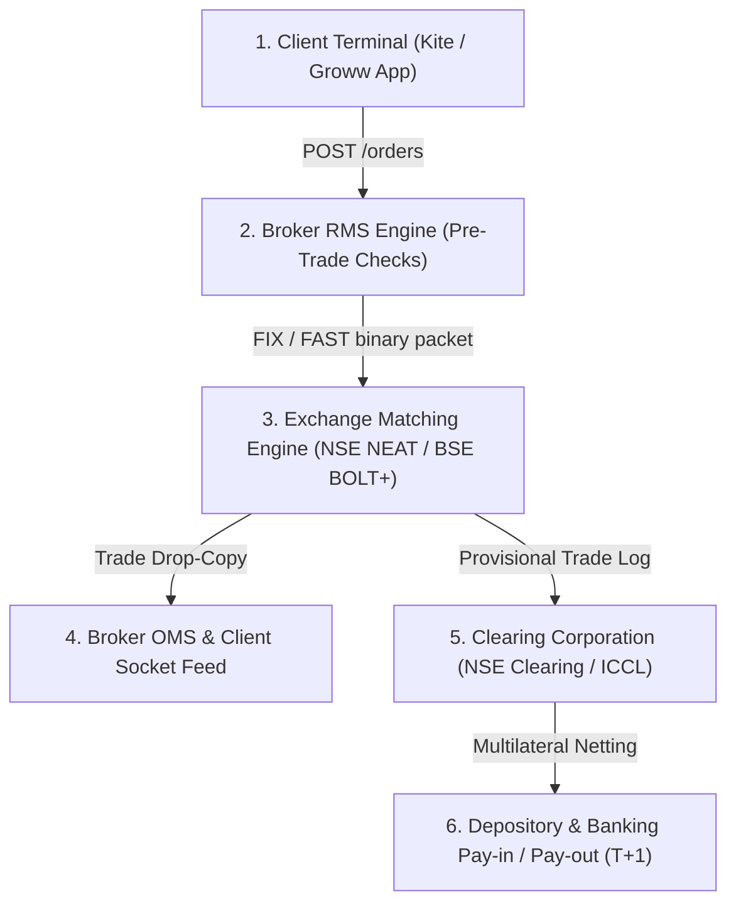

# Institutional FinTech Research Whitepaper: Indian Discount Broking Architecture, Telemetry Pipelines, and Quantitative Risk Systems

**Document Reference:** `5_FinTech_Research_Report.md`  
**Primary Subjects:** Zerodha Broking Limited & Groww (Nextbillion Technology Private Limited)  
**Classification:** Financial Engineering, Depository Architecture, High-Frequency Telemetry, Real-Time RMS  
**Regulatory Jurisdiction:** Securities and Exchange Board of India (SEBI) | Depositories Act, 1996  

---

## Executive Summary

The Indian retail brokerage landscape has undergone a profound technological disruption over the past decade, driven by India Stack infrastructure (Aadhaar e-KYC, DigiLocker, UPI, NPCI e-Mandates) and the unbundling of traditional full-service banking brokerages. Discount brokerages led by **Zerodha** (active client pioneer) and **Groww** (active user leader) have democratized market access, scaling demat accounts nationwide from ~20 million in 2014 to over 160 million by 2024.

This quantitative whitepaper delivers an exhaustive institutional deconstruction of:
1. **Brokerage Operational Mechanics, Depository Interfaces (NSDL/CDSL), and the SEBI Compliance Envelope**.
2. **The End-to-End Trading Lifecycle, $T+1$ Settlement Mechanics, and the Emerging $T+0$ Direct Payout Architecture**.
3. **Algorithmic Trading Systems: Kite Connect v3 REST & Binary WebSocket Protocol Specifications**.
4. **High-Frequency Trade Telemetry, Stream Processing, and Real-Time Risk Management Systems (RMS)**.
5. **Comparative Unit Economics, Behavioral Nudge Engines, and Risk-Mitigation Interventions**.

---

# 1. Operational Mechanics, Account Taxonomy & Depository Systems

```
                           ┌────────────────────────┐
                           │      Retail Client     │
                           └───────────┬────────────┘
                                       │
                ┌──────────────────────┴──────────────────────┐
                ▼                                             ▼
   ┌─────────────────────────┐                   ┌─────────────────────────┐
   │     Trading Account     │                   │      Demat Account      │
   │   (Managed by Broker)   │                   │ (Maintained by Depository)│
   ├─────────────────────────┤                   ├─────────────────────────┤
   │ • Unique Client Code    │                   │ • 16-Digit BOID         │
   │ • Cash Ledger & Margins │                   │ • Safekeeping of Shares │
   │ • Order Routing Engine  │                   │ • NSDL / CDSL Vault     │
   │ • Exposure Management   │                   │ • Corporate Actions Hub │
   └─────────────────────────┘                   └─────────────────────────┘
                │                                             ▲
                │         Trade Settlement Pay-in / Pay-out   │
                └─────────────────────────────────────────────┘
```

### 1.1 Trading Account vs. Demat Account Legal Structure

Under the SEBI (Stock Brokers and Sub-Brokers) Regulations, 1992 and the Depositories Act, 1996, a market participant maintains two distinct, decoupled accounts:

| Structural Property | Trading Account | Demat (Dematerialized) Account |
| :--- | :--- | :--- |
| **Legal Status** | Transacting facility / Broker-client ledger | Electronic ownership registry / Custodial vault |
| **Administering Entity** | The Stock Broker (Trading Member - TM) | The Central Depositories (**NSDL** or **CDSL**) |
| **Primary Account Key** | **UCC (Unique Client Code)** (e.g., `AB1234`) | **BOID (Beneficiary Owner ID)** (16 numeric digits) |
| **Asset Class Maintained** | Unencumbered fiat currency (INR cash ledger, trading margin) | Dematerialized securities (Equities, ETFs, SGBs, Mutual Funds) |
| **Balance Sheet Position** | Recorded as a liability on the broker's client ledger | Independent custodial asset; completely off-balance-sheet for broker |
| **Regulatory Protections** | Protected under SEBI Investor Protection Fund (IPF up to ₹25L) | Protected directly by statutory ownership under the Depositories Act |

---

### 1.2 Depository Infrastructure: NSDL vs. CDSL

India operates a competitive dual-depository structure regulated under SEBI oversight to eliminate paper share certificates, counterfeit delivery risks, and settlement friction:

```
                            ┌────────────────────────┐
                            │      SEBI Oversight    │
                            └───────────┬────────────┘
                                        │
             ┌──────────────────────────┴──────────────────────────┐
             ▼                                                     ▼
┌──────────────────────────────┐              ┌──────────────────────────────┐
│  NSDL (National Securities   │              │   CDSL (Central Depository   │
│     Depository Limited)      │              │      Services Limited)       │
├──────────────────────────────┤              ├──────────────────────────────┤
│ • Promoted by NSE, IDBI, UTI │              │ • Promoted by BSE, SBI, BOI  │
│ • Est. 1996 (First in India) │              │ • Est. 1999 (Publicly Listed)│
│ • Dominant in Institutional  │              │ • Dominant in Retail Broking │
│ • Account: 'IN' + 14 Digits  │              │ • Account: 16 Pure Digits    │
└──────────────────────────────┘              └──────────────────────────────┘
```

#### The Depository Participant (DP) Role
Brokers operate as **Depository Participants (DPs)**—registered financial intermediaries between beneficial owners and central depositories. Zerodha operates as a self-clearing DP registered with CDSL (`DP ID: 12081600`), while Groww operates via Nextbillion Technology (`DP ID: 12088700`).

#### Electronic Delivery Instruction Slip (e-DIS) & T-PIN Authentication
Historically, clients executed physical Power of Attorney (PoA) deeds authorizing brokers to debit shares. Under SEBI Circular `SEBI/HO/MIRSD/DOP/CIR/P/2020/158`, physical PoAs were phased out in favor of **e-DIS**:
1. When selling equity delivery positions, the user initiates an e-DIS authorization call from the trading UI.
2. The browser redirects to CDSL/NSDL secure gateway where the user inputs a **6-digit CDSL T-PIN** plus an **SMS/Email Time-based One-Time Password (TOTP)** directly to the depository.
3. Upon cryptographic validation, the depository grants a pre-authorized debit token valid for a single trading session, preventing unauthorized broker access.

#### SEBI Margin Pledge / Re-Pledge Protocol
Under SEBI circular `SEBI/HO/MIRSD/DOP/CIR/P/2020/28`:
- Securities pledged by an investor to obtain derivative margin never leave the client’s own demat account.
- The depository places an electronic **Pledge Marker** in favor of the broker's designated client pledge account.
- The broker re-pledges the marker to the **Clearing Corporation (NSCCL / ICCL)**.
- Dividends, bonus shares, voting rights, and corporate actions flow directly and uninterrupted to the investor's bank and demat accounts.

---

### 1.3 SEBI Regulatory Compliance Architecture

Discount brokers operate under automated, algorithmically enforced compliance rules to prevent broker insolvency and protect systemic liquidity:

```
┌─────────────────────────────────────────────────────────────────────────┐
│                       SEBI Regulatory Pillars                           │
└────────────────────────────────────┬────────────────────────────────────┘
                                     │
     ┌───────────────────────────────┼───────────────────────────────┐
     ▼                               ▼                               ▼
┌─────────────────────────┐     ┌─────────────────────────┐     ┌─────────────────────────┐
│  Peak Margin Mandate    │     │ Client Fund Segregation │     │ Quarterly Bank Settle   │
├─────────────────────────┤     ├─────────────────────────┤     ├─────────────────────────┤
│ • 100% Upfront Margin   │     │ • Client & Prop Books   │     │ • Return idle funds     │
│ • Intraday leverage cap │     │   strictly segregated   │     │ • Monthly/Quarterly     │
│ • 4 Random Snapshots/day│     │ • Daily bank reporting  │     │ • First Friday sweeps   │
└─────────────────────────┘     └─────────────────────────┘     └─────────────────────────┘
```

1. **Upfront Peak Margin Mandate (100% Margin Enforced)**:
   - Brokers are legally barred from offering unhedged intraday leverage. Clients must post 100% of the exchange-mandated margin (VaR + ELM for equities, SPAN + Exposure for derivatives) prior to order dispatch.
   - Clearing corporations execute **4 random intraday snapshot sweeps** during trading hours; any margin shortfall detected across snapshots triggers progressive monetary penalties on the broker.
2. **Strict Segregation of Client Assets**:
   - Following the Karvy Stock Broking default, SEBI prohibited brokers from using client funds or securities to finance proprietary trading or fund third-party loans.
   - Brokers must transmit end-of-day client asset balances to clearing corporations daily, reconciled against bank statement data.
3. **Quarterly Running Account Settlement (Client Fund Sweep)**:
   - To eliminate broker float manipulation, brokers must automatically sweep all unencumbered client cash ledger balances back to the investor’s primary bank account on the **first Friday of every quarter or month**.

---

# 2. End-to-End Trading Lifecycle & The $T+1$ (and $T+0$) Settlement Framework

India operates the **$T+1$ Rolling Settlement Cycle**, reducing counterparty risk by settling trades within 24 hours of execution.

```
                           Trade Day (T)                                       Settlement Day (T+1)
┌───────────────────────────────────────────────────────────────┐     ┌───────────────────────────────────────┐
│ 09:15 - 15:30 IST       16:00 - 18:30 IST    20:00 - 23:00 IST│     │ 08:30 - 10:30 IST   11:00 - 13:00 IST │
│   Trade Execution         Clearing Netting     Digital Contract│    │   Pay-in Obligations    Pay-out & Demat │
│   (Matching Engine)      (CC Multilateral)         Notes       │    │   Funds & Securities       Credit       │
└───────────────────────────────────────────────────────────────┘     └───────────────────────────────────────┘
```

### 2.1 The Six-Stage Trading Lifecycle



#### Stage 1: Pre-Trade Risk Management System (RMS)
- Executes sub-5ms checks on account cash, pledged collateral, security price bands, ASM/GSM surveillance lists, and open position limits before order dispatch to the exchange.

#### Stage 2: Order Routing & Exchange Matching
- High-throughput gateways format orders into binary protocols (FIX/FAST) over dedicated 10 Gbps co-location / leased lines.
- The central order book matches orders based on **Price-Time Priority**.

#### Stage 3: Execution Confirmation & Digital Contract Notes
- The exchange broadcasts execution receipts to the broker OMS.
- Under SEBI rules, an **Electronic Contract Note (ECN)** cryptographically signed via an X.509 digital certificate is issued within 24 hours, detailing:
  - *Brokerage*: Capped at ₹20 per executed order.
  - *Securities Transaction Tax (STT)*: 0.1% on delivery buy/sell; 0.125% on exercised options; 0.02% on intraday sell.
  - *Exchange Transaction Charges*: ~0.00345% paid to NSE/BSE.
  - *SEBI Turnover Charges*: ₹10 per ₹1 Crore of turnover.
  - *Goods & Services Tax (GST)*: 18% levied on (Brokerage + Exchange Fees + SEBI Fees).
  - *State Stamp Duty*: 0.015% on equity delivery buyers under the Indian Stamp Act.

#### Stage 4: Clearing Corporation Multilateral Netting
- At market close, clearing corporations aggregate all trades across trading members to establish net funds pay-in/pay-out and net security obligations.

---

### 2.2 Chronological Breakdown of the $T+1$ Settlement Cycle

| Settlement Stage | Timeline (IST) | Operational Mechanism & System Action |
| :--- | :--- | :--- |
| **Trade Day ($T$)** | `09:15 – 15:30` | Real-time market execution across cash and derivatives segments. |
| **Trade Day ($T$)** | `15:30 – 16:30` | Exchange compiles provisional trade files and transmits them to **NSE Clearing (NSCCL)** or **ICCL**. |
| **Trade Day ($T$)** | `17:00 – 19:00` | Clearing Corporation runs **Multilateral Netting**: aggregates all trades per broker to arrive at net fund obligations (pay-in/pay-out) and net security delivery counts. |
| **Trade Day ($T$)** | `20:00 – 23:30` | Broker RMS generates contract notes, updates client ledgers, and queues depository instructions for morning clearing. |
| **Settlement Day ($T+1$)** | `08:30 – 09:30` | **Securities Pay-in**: Selling brokers transfer net shares from client demat accounts (via e-DIS/pledge) to the Clearing Corporation account. |
| **Settlement Day ($T+1$)** | `10:00 – 11:00` | **Funds Pay-in**: Buying brokers transfer net fiat funds from clearing accounts to the Clearing Corporation via designated clearing banks. |
| **Settlement Day ($T+1$)** | `11:00 – 13:00` | **Funds & Securities Pay-out**: Clearing Corporation transfers cash to selling brokers and credits shares into buying clients' demat accounts at NSDL/CDSL. |
| **Settlement Day ($T+1$)** | `13:00 – 15:30` | Shares reflect in buyer's holdings as fully settled equity available for sale or pledge. |

---

### 2.3 Emerging Frameworks: $T+0$ Beta & Direct Payout of Securities

1. **$T+0$ Same-Day Settlement (Beta Launched March 2024)**:
   - Operates in parallel with $T+1$ for an initial basket of 25 liquid equities. Trades executed up to 13:30 IST settle cash and securities by 16:30 IST on the same trading day.
2. **Direct Payout of Securities to Client Demat Accounts (Effective Late 2024)**:
   - SEBI circular mandated that clearing corporations must credit purchased shares **directly into the investor's demat account**, bypassing the broker’s pool account entirely and eliminating broker misappropriation risks.

---

# 3. Algorithmic Trading APIs: Kite Connect v3 Protocol Architecture

Zerodha's **Kite Connect v3** is the premier retail algorithmic API in India, enabling retail traders, quant hedge funds, and fintech platforms to automate trading execution.

```
┌─────────────────────────────────┐                 ┌─────────────────────────────────┐
│     Client Trading Strategy     │                 │   Kite Connect v3 REST API      │
│     (Python / Go / Node.js)     │                 │  (api.kite.trade / HTTP/2)      │
│  • Generates order signals      │  POST /orders   │  • Rate Limits: 3 req/sec orders│
│  • Monitors portfolio risk      │ ───────────────>│  • Checksum Auth: SHA-256       │
│  • Consumes live tick feed      │ <────────────── │  • JSON Response Envelope       │
└─────────────────────────────────┘   WebSocket     └─────────────────────────────────┘
                 ▲                     (Binary Ticker)               │
                 │                                                   ▼
                 └─────────────────────────────────────── NSE / BSE Exchange Gateways
```

### 3.1 Authentication Handshake & Cryptographic Checksum

Kite Connect enforces a multi-tier cryptographic authentication handshake:
1. Client initiates login via browser redirect to `https://kite.zerodha.com/connect/login?api_key={api_key}&v=3`.
2. Upon user authentication and 2FA TOTP verification, Kite redirects to client callback URL with a temporary `request_token`.
3. Client exchanges `request_token` for a persistent `access_token` by computing a SHA-256 signature:

$$\text{api\_secret\_hash} = \text{SHA256}\left(\text{api\_key} + \text{request\_token} + \text{api\_secret}\right)$$

```http
POST /session/token HTTP/1.1
Host: api.kite.trade
Content-Type: application/x-www-form-urlencoded

api_key=your_api_key&request_token=incoming_token&checksum=computed_sha256_hash
```

4. Server responds with a session `access_token` valid for the entire trading day until 06:00 IST the next morning.
5. Every subsequent API request passes authorization headers:
```http
Authorization: token api_key:access_token
```

---

### 3.2 Endpoint Architecture & Rate Limit Specifications

To prevent exchange infrastructure saturation and adhere to SEBI algorithmic trading guidelines, Kite Connect enforces strict rate limiting per API key:

| Endpoint Route | HTTP Method | Rate Limit Mandate | Purpose & Payload Description |
| :--- | :---: | :--- | :--- |
| `/orders/{variety}` | `POST` | **3 requests / second** | Order placement (`variety`: regular, amo, ice-berg). Payload: `tradingsymbol`, `exchange`, `transaction_type`, `quantity`, `order_type`, `price`. |
| `/orders/{variety}/{order_id}` | `PUT` | **3 requests / second** | Order modification (price, quantity). |
| `/orders/{variety}/{order_id}` | `DELETE` | **3 requests / second** | Order cancellation. |
| `/quote` | `GET` | **1 req / second (up to 500 syms)** | Full quote snapshot (LTP, OHLC, volume, 5-depth bid/ask). |
| `/instruments/historical/...` | `GET` | **3 requests / second** | Historical OHLCV candle extraction. |
| `/portfolio/positions` | `GET` | **10 requests / second** | Real-time open intraday and overnight positions. |

---

### 3.3 Kite WebSocket Streaming Ticker (Binary Protocol)

Market ticks are streamed over persistent full-duplex WebSockets (`wss://ws.kite.trade?api_key=...&access_token=...`). Rather than sending verbose JSON, Kite utilizes a proprietary **compact binary packet format** to minimize bandwidth and TCP packet fragmentation.

#### Binary Packet Layout (Full Mode: 184 Bytes per Instrument):

```
Byte Offset:   0       2       4               8               12              16
               ┌───────┬───────┬───────────────┬───────────────┬───────────────┐
               │ Packets│ Packet│  Instrument   │ Last Traded   │ Last Traded   │ ...
               │ Count │ Length│     Token     │  Price (LTP)  │   Quantity    │
               │ (int16│(int16)│    (int32)    │    (int32)    │    (int32)    │
               └───────┴───────┴───────────────┴───────────────┴───────────────┘
```

- **Byte 0–1**: Number of instrument packets in message (`int16`).
- **Byte 2–3**: Individual packet byte length (`int16`).
- **Byte 4–7**: Exchange Instrument Token ID (`int32`).
- **Byte 8–11**: Last Traded Price (LTP) in paise (`int32`, divide by 100 for INR).
- **Byte 12–15**: Last Traded Quantity (`int32`).
- **Byte 16–19**: Average Traded Price (ATP) in paise (`int32`).
- **Byte 20–23**: Volume traded today (`int32`).
- **Byte 24–39**: Day's Open, High, Low, Close (4 $\times$ `int32` in paise).
- **Byte 40–183**: **Market Depth (5 Bids + 5 Asks)**: 10 entries $\times$ 12 bytes each (`quantity` `int32`, `price` `int32`, `orders` `int16`, `padding` `int16`).

*Processing efficiency: A single Go or Rust worker can deserialize over 250,000 binary market depth ticks per second with zero garbage-collection latency.*

---

# 4. Telemetry Pipelines & Real-Time Risk Management Systems (RMS)

```
                          Event Telemetry Pipeline
┌─────────────────────────┐     ┌─────────────────────────┐     ┌─────────────────────────┐
│ Client Terminal Events  │     │ Distributed Message Bus │     │ Stream Analytics Engine │
│ • Clickstream latency   │ ──> │ • Apache Kafka          │ ──> │ • Apache Flink / Spark  │
│ • Order modifications   │     │ • 1.5B+ Events / day    │     │ • Real-time feature calc│
│ • Rapid cancel streaks  │     └─────────────────────────┘     └───────────┬─────────────┘
└─────────────────────────┘                                                 │
                                ┌───────────────────────────────────────────┴─────────────┐
                                ▼                                                         ▼
                  ┌───────────────────────────┐                             ┌───────────────────────────┐
                  │    Behavioral Interventions│                            │  Predictive Risk Systems  │
                  ├───────────────────────────┤                             ├───────────────────────────┤
                  │ • Contextual "Nudges"     │                             │ • Margin Shortfall Model  │
                  │ • Kill Switch Triggers    │                             │ • Auto-Square-off Engine  │
                  │ • F&O Loss Ratio Warnings │                             │ • Black-Swan Stress Test  │
                  └───────────────────────────┘                             └───────────────────────────┘
```

### 4.1 Telemetry Architecture & Stream Ingestion

Discount brokerages process massive event streams during peak volatility windows (e.g., Union Budget announcements, election results):
- **Kafka Cluster Sizing**: Brokers deploy multi-broker Apache Kafka clusters handling over **1.5 Billion messages daily**, partitioned by `user_id` and `instrument_token` to ensure strictly ordered sequence processing.
- **Latency SLAs**:
  - *Internal Network Transit*: Edge Gateway to RMS $< 2\text{ms}$.
  - *RMS In-Memory Validation*: $< 1.5\text{ms}$.
  - *Order Matching Round-Trip*: $< 15\text{ms}$ (Leased line to NSE Colo at BKC Mumbai).

---

### 4.2 Algorithmic Risk Management Engine (RMS)

Because brokers are held strictly liable by clearing corporations for client margin deficits, real-time automated RMS engines enforce hard risk boundaries:

1. **Dynamic Real-Time SPAN & VaR Margin Re-evaluation**:
   - The RMS continuously recalculates portfolio **Standard Portfolio Analysis of Risk (SPAN)** and **Value at Risk (VaR)** across hundreds of thousands of open derivative positions as underlying prices oscillate.
2. **Automated Intraday Auto-Square-Off (MIS Liquidation)**:
   - For intraday positions (MIS – Margin Intraday Square-off), if market volatility erodes **70% to 80%** of an account’s deposited cash margin buffer, the RMS triggers an automated market square-off order without manual intervention, neutralizing broker credit default exposure.
   - At **15:20 IST** (10 minutes prior to market close), any remaining open MIS positions are automatically liquidated by scheduled batch square-off algorithms.
3. **Runaway Algorithmic Kill-Switch**:
   - Automated rate-limit monitors identify aberrant client algorithms placing $>20$ modifications per second, immediately severing the client's API socket connection to prevent order-book manipulation penalties.

---

### 4.3 Behavioral Interventions: Nudges & Self-Regulation

To curb destructive retail speculative habits, platforms implement algorithmic friction directly in the trading interface:
1. **Contextual Nudges (Zerodha Nudge Framework)**:
   - *Penny Stock Nudge*: Warns users when purchasing illiquid, operator-manipulated micro-cap stocks.
   - *Illiquid Options Nudge*: Alerts users attempting to purchase deep Out-of-the-Money (OTM) options with zero open interest and extreme bid-ask spreads.
   - *Mandatory SEBI Risk Notice*: Informs users on every derivative order entry that **93% of individual retail traders in equity F&O incurred net losses** over FY22–FY24.
2. **The Trader "Kill Switch"**:
   - A behavioral self-control tool enabling traders to manually disable trading across specific segments (F&O, Commodities, Equities).
   - Once activated, the kill switch revokes trading authorization for **12 consecutive hours**, preventing emotional "revenge trading" spirals following significant drawdowns.

---

# 5. Comparative Business Models: Zerodha vs. Groww

| Strategic Dimension | Zerodha (Zerodha Broking Limited) | Groww (Nextbillion Technology Private Limited) |
| :--- | :--- | :--- |
| **Founding & Capitalization**| Founded 2010; **100% Bootstrapped**; Zero institutional venture capital | Founded 2016; **VC-backed** (Tiger Global, Peak XV, Ribbit); Well capitalized |
| **Core Target Audience** | Active derivative traders, algorithmic quants, sophisticated investors | Millennial retail investors, mutual fund accumulators, first-time equity buyers |
| **Product Ecosystem** | Kite (Trading), Console (Analytics), Coin (MFs), Kite Connect (APIs), Varsity | Groww App (Integrated Stocks, Direct MFs, US Equities, Personal Loans, UPI) |
| **Monetization Engine** | Flat ₹20 per executed F&O/Intraday trade; ₹0 equity delivery; Float treasury income | Brokerage on equity trades; Consumer lending / personal credit distribution fees |
| **FY24 Financial Performance**| Revenue: **₹8,370 Crores** \| PAT: **₹4,700 Crores** (Operating Margin $> 55\%$) | Revenue: **₹3,145 Crores** \| Rapid revenue growth; Transitioning to net profitability |
| **Headcount & Efficiency** | **~1,200 employees** (Unmatched revenue per employee $> ₹6.9\text{ Cr}$) | **~2,500+ employees** (Extensive engineering, customer success, marketing teams) |
| **User Acquisition Strategy** | Zero paid marketing; Organic word-of-mouth powered by **Varsity** education | Aggressive digital acquisition, influencer marketing, high-volume app store funnels |

---

## Conclusion & Strategic Outlook

The structural competitive advantage of Indian discount brokers rests upon software automation:
1. **Frictionless Capital Formation**: API-driven onboarding via DigiLocker and instant settlements have compressed customer acquisition costs from ₹2,500 per user in the physical branch era to under ₹300 today.
2. **Defensive Balance Sheets**: Upfront peak margins and automated auto-square-off mechanisms make discount brokers virtually credit-risk free.
3. **Future Strategic Frontier**: As SEBI rolls out instantaneous **$T+0$ settlement** and direct clearinghouse-to-demat payouts, platforms must transition from batch clearing interfaces to sub-second event-driven reconciliation, positioning real-time telemetry and API resilience as the defining determinants of market leadership.
