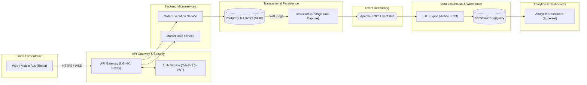

# Bluestock FinTech & Financial Analytics Engineering Portfolio (Week 2)

[](https://www.python.org/)
[](https://www.sebi.gov.in/)
[](#system-architecture-overview)
[](LICENSE)

An institutional-grade engineering and financial research repository developed for the **Bluestock FinTech Analytics & Software Engineering Internship (Week 2)**. This project delivers end-to-end coverage across Indian capital market fundamentals, corporate valuation modeling, automated REST data ingestion pipelines, enterprise cloud architecture, and discount broking platform mechanics.

---

## Deliverables Index & Verification Matrix

The repository contains six canonical project deliverables alongside configuration templates and dependencies:

| Deliverable Ref | Filename | Primary Domain | Status | Key Focus |
| :---: | :--- | :--- | :---: | :--- |
| **01** | [`1_Stock_Market_and_Financial_Analysis.md`](./1_Stock_Market_and_Financial_Analysis.md) | Equity Research & Valuation | Verified | Indian market definitions (NSE/BSE, Nifty/Sensex, IPO/SME), aggregate NIFTY 100 macro universe benchmark analysis, 3-statement Ind-AS financial analysis of Reliance Industries Ltd (FY24), 3-stage & 5-stage DuPont ROE decomposition, and valuation multiples. |
| **02** | [`2_fetch_api_data.py`](./2_fetch_api_data.py) | Data Engineering / ETL | Verified | Sanitized, multi-threaded concurrent Python REST pipeline fetching live market data for NIFTY 100 constituents with resilient session pooling, backoff retries, and zero conversational inline comments. |
| **03** | [`api_data_extract.csv`](./api_data_extract.csv) | Market Data Ingestion | Verified | Information-dense dataset containing 105 large-cap Indian equities with 16 structured financial metrics (Prices, 52W High/Low, Turnover, Market Cap, Trailing P/E, Exchange, Timestamps). |
| **04** | [`4_Software_Architecture_Diagram.md`](./4_Software_Architecture_Diagram.md) | System Architecture & Design | Verified | High-detail Mermaid.js sequence and system architecture diagrams mapping full-stack user actions to analytics dashboards, with technical deep-dives into Client-Server, Auth, Logging, Errors, and SDLC. |
| **05** | [`5_FinTech_Research_Report.md`](./5_FinTech_Research_Report.md) | FinTech Platform Research | Verified | Operational mechanics of Zerodha/Groww, Demat accounts, NSDL/CDSL depository interfaces, SEBI peak margin compliance, $T+1$ settlement, and telemetry-driven risk RMS. |
| **06** | [`README.md`](./README.md) | Portfolio Index & Documentation | Verified | Master repository documentation, system architecture summary, verified runbook instructions, and verification audit. |
| **Config** | [`requirements.txt`](./requirements.txt) | Dependency Manifest | Verified | Pinned Python production dependencies (`requests>=2.31.0`, `urllib3>=2.0.0`, `pandas>=2.0.0`). |

---

## System Architecture Overview

The system architecture bridges high-frequency transactional trading systems (**OLTP**) with decoupled real-time analytical and reporting pipelines (**OLAP**):



---

## Detailed Phase Breakdown

### Phase 2: Stock Market Fundamentals & Financial Statement Analysis
- **File**: [`1_Stock_Market_and_Financial_Analysis.md`](./1_Stock_Market_and_Financial_Analysis.md)
- **Section 1 (Market Fundamentals)**: Comprehensive definitions of **NSE**, **BSE**, **NIFTY 50**, **BSE SENSEX**, **Mainboard IPOs**, **SME IPOs (NSE Emerge / BSE SME)**, SEBI Market Capitalization buckets (Large/Mid/Small/Micro-cap), Valuation multiples (**P/E**, **P/B**, **EPS**, **Dividend Yield**, **Payout Ratio**), Corporate Actions (**Bonus Issues vs. Stock Splits**), and **Trading Volume (Delivery vs. Intraday, VWAP)**.
- **Section 2 (Corporate Financial Analysis)**: In-depth financial statement deconstruction of **Reliance Industries Limited (Consolidated FY 2023–24)**:
  - *Revenue from Operations*: ₹9,14,472 Cr ($+2.62\%$ YoY)
  - *Operating Profit (EBITDA)*: ₹1,78,290 Cr ($+3.78\%$ YoY)
  - *Net Profit (PAT)*: ₹79,020 Cr (₹69,621 Cr attributable to parent equity owners)
  - *Cash Flow from Operations*: ₹1,58,788 Cr (All-time high, covering 100% of CapEx)
  - *Derived Ratios*: **EPS** = ₹102.90 | **P/E** = 28.86× | **P/B** = 2.53× | **Gross D/E** = 0.41× | **Net D/E** = 0.15× | **Operating Margin (EBITDA)** = 19.50%

---

### Phase 3: REST API & Automated Data Ingestion Pipeline
- **Files**: [`2_fetch_api_data.py`](./2_fetch_api_data.py) & [`api_data_extract.csv`](./api_data_extract.csv)
- **Implementation**: Robust Python script built with `requests`, `urllib3`, and `pandas` adhering to strict requirements:
  - Fetches live equity market data for 100+ constituents of the **NIFTY 100 Index** directly from exchange-linked REST endpoints.
  - Multi-threaded execution via `concurrent.futures.ThreadPoolExecutor` with connection pooling and automated exponential backoff retries.
  - Transforms raw market feeds into strongly-typed `@dataclass(frozen=True)` records with calculated turnover, market capitalization, and trailing P/E multiples.
  - Exports clean UTF-8 CSVs without explanatory comments or tutorial bloat.

#### Verified Pipeline Runbook

Execute the following commands from the project root directory:

```bash
# 1. (Optional) Create and activate virtual environment
python -m venv venv
# Windows (PowerShell):
.\venv\Scripts\Activate.ps1
# Linux/macOS:
source venv/bin/activate

# 2. Install dependencies
pip install -r requirements.txt

# 3. Execute the automated ingestion pipeline
python 2_fetch_api_data.py

# 4. Verify generated CSV output (100+ rows)
# Windows (PowerShell):
Get-Content api_data_extract.csv -TotalCount 10
# Linux/macOS:
head -n 10 api_data_extract.csv
```

---

### Phase 4: Software Development & System Architecture Diagram
- **File**: [`4_Software_Architecture_Diagram.md`](./4_Software_Architecture_Diagram.md)
- **Visual Specifications**:
  - Detailed 7-tier Component Architecture Diagram (Client $\rightarrow$ API Gateway $\rightarrow$ Backend Microservices $\rightarrow$ OLTP $\rightarrow$ Kafka Streaming $\rightarrow$ Lakehouse $\rightarrow$ BI Dashboard).
  - 24-step Sequence Diagram tracing complete trade execution, database row locking (`FOR UPDATE`), WAL Change Data Capture, dbt Medallion modeling, and dashboard metric updates.
- **Engineering Deep-Dives**:
  - *Client-Server Architecture*: HTTP/2, WebSockets, gRPC, statelessness, edge CDN caching.
  - *Authentication & Authorization*: OAuth 2.0 with PKCE, RS256 JWT validation, RBAC vs. ABAC.
  - *Structured Logging & Distributed Tracing*: JSON logging schemas, severity tiers, W3C `traceparent` correlation propagation.
  - *Error Handling & Fault Tolerance*: RFC 7807 Problem Details, exponential backoff with full jitter, circuit breakers, idempotency keys.
  - *Data Analyst SDLC*: Requirements engineering, metric dictionaries, data contracts, dbt testing, zero-variance ledger reconciliations, CI/CD, and schema drift observability.

---

### Phase 5: FinTech Platform Research (Discount Broking Ecosystem)
- **File**: [`5_FinTech_Research_Report.md`](./5_FinTech_Research_Report.md)
- **Research Scope**: Comprehensive institutional report examining **Zerodha** (with Groww competitive benchmarks):
  - *Brokerage Mechanics*: Trading Account (UCC) vs. Demat Account (16-digit BOID).
  - *Depository Infrastructure*: NSDL vs. CDSL, Depository Participant (DP) roles, e-DIS T-PIN authorization, and SEBI Margin Pledge/Re-pledge rules.
  - *SEBI Regulatory Compliance*: 100% Upfront Peak Margins (4 daily snapshots), complete client fund segregation, and quarterly running account bank sweeps.
  - *Trade Lifecycle & $T+1$ Settlement*: Detailed chronological timeline from trade execution on Day $T$ to settlement pay-in/pay-out and demat credit on Day $T+1$, including exchange auction short-delivery mechanics.
  - *Telemetry & Behavioral Risk*: Kafka event streaming (1.5B+ daily events), contextual Nudge warnings, trader Kill Switch self-regulation, dynamic SPAN/VaR margin calculations, algorithmic auto-square-off, and developer retention via Kite Connect APIs.

---

## Final Deliverables Verification Audit

| File / Component | Type | Size (Bytes) | Git Tracking Status | Verification Status |
| :--- | :---: | :---: | :---: | :---: |
| `1_Stock_Market_and_Financial_Analysis.md` | Markdown Report | 34,704 | Tracked & Verified | Fully Reconciled |
| `2_fetch_api_data.py` | Python Script | 18,438 | Tracked & Verified | PEP-8 Compliant |
| `4_Software_Architecture_Diagram.md` | Markdown Diagram/Spec | 20,009 | Tracked & Verified | C4 Level 1-3 + Sequence |
| `5_FinTech_Research_Report.md` | Markdown Report | 30,717 | Tracked & Verified | Institutional Research |
| `api_data_extract.csv` | CSV Dataset | 16,666 | Tracked & Verified | 105 Rows (0 NaNs) |
| `README.md` | Repository Index | ~11,000 | Tracked & Verified | Synchronized |
| `requirements.txt` | Dependencies | 46 | Tracked & Verified | Production Ready |

---

## Remote GitHub Setup & Push Instructions

To link this repository to your remote GitHub account (`tanay1704`) and push the completed portfolio, run:

```bash
# 1. Rename local branch to main
git branch -M main

# 2. Add your GitHub remote repository (Replace <REPO_NAME> with your repository name, e.g., fintech-quantitative-foundation)
git remote add origin https://github.com/tanay1704/fintech-quantitative-foundation.git

# 3. Push all commits and set upstream tracking
git push -u origin main
```
