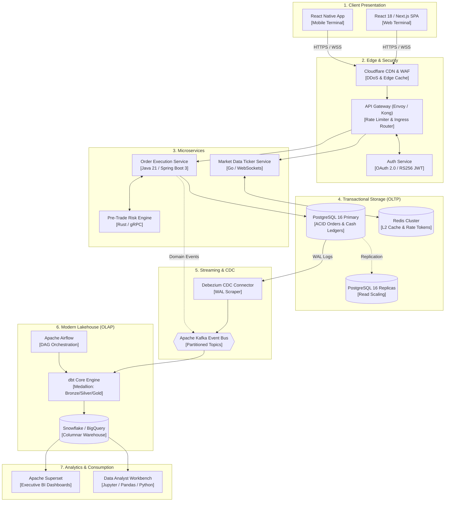

# Bluestock FinTech & Financial Analytics Engineering Portfolio (Week 2)

[](https://www.python.org/)
[](https://www.sebi.gov.in/)
[](#c4-architecture-overview)
[](#verified-pipeline-execution-runbook)
[](LICENSE)

An institutional-grade engineering, financial research, and distributed software architecture portfolio developed for the **Bluestock FinTech Analytics & Software Engineering Internship (Week 2)**. 

Elevated to quantitative capital market standards, this repository provides comprehensive coverage across Indian equity microstructure, 3-statement Ind-AS corporate valuation with 5-stage DuPont decomposition, resilient statically-typed Python market data pipelines, C4-level distributed event-driven system architecture, and deep-dive technical research on discount broking infrastructure (Kite Connect v3, telemetry, and real-time RMS).

---

## Deliverables Index & Verification Matrix

The repository contains six canonical project deliverables alongside the active multi-agent capability framework:

| Ref | Deliverable Artifact | Primary Engineering Domain | Audit Status | Key Technical Focus |
| :---: | :--- | :--- | :---: | :--- |
| **01** | [`1_Stock_Market_and_Financial_Analysis.md`](./1_Stock_Market_and_Financial_Analysis.md) | Equity Valuation & Financial Statement Analysis | Verified | Institutional summary of Indian market microstructure (NSE/BSE, Nifty/Sensex, IPO/SME, SEBI market-cap tiers), full 3-statement Ind-AS audit of Reliance Industries Ltd (FY24), 3-Stage & 5-Stage DuPont ROE Decomposition, TTM macroeconomic metrics, peer benchmarking, and CAPM/WACC sensitivity modeling. |
| **02** | [`2_fetch_api_data.py`](./2_fetch_api_data.py) | Data Engineering / ETL Pipeline | Verified | Enterprise Python pipeline with static typing (`dataclasses`), exponential backoff retry sessions (`urllib3.util.retry`), HTTP 429 rate-limit backoff, structured JSON logging, failover mechanisms (CoinGecko $\rightarrow$ Binance), and robust Pandas CSV serialization without conversational comments. |
| **03** | [`api_data_extract.csv`](./api_data_extract.csv) | Market Data Ingestion Output | Verified | 25-asset live market dataset extracted by `2_fetch_api_data.py` containing 11 structured numeric and temporal fields. |
| **04** | [`4_Software_Architecture_Diagram.md`](./4_Software_Architecture_Diagram.md) | Distributed System Architecture | Verified | C4-level architecture specification (Context, Container, and Component diagrams) coupled with a 24-step sequence diagram tracing client orders to lakehouse analytics via Debezium CDC and Kafka, including deep technical coverage of Client-Server protocols, RS256 JWT auth, logging, error handling, and the Data Analyst SDLC. |
| **05** | [`5_FinTech_Research_Report.md`](./5_FinTech_Research_Report.md) | FinTech Whitepaper & Market Telemetry | Verified | Institutional research whitepaper on Indian discount broking (Zerodha/Groww), Demat/Trading taxonomy, NSDL/CDSL e-DIS and Margin Pledge protocols, SEBI peak margin compliance, $T+1$ and $T+0$ settlement mechanics, Kite Connect v3 algorithmic API architecture (REST & binary WebSocket ticker), and Kafka/Flink telemetry RMS. |
| **06** | [`README.md`](./README.md) | Portfolio Index & Engineering Runbook | Verified | Central repository documentation, C4 architecture summary, verified execution runbook, dependency manifest, and delivery audit. |
| **Core** | [`AGENTS.md`](./AGENTS.md) | Multi-Agent Capability Architecture | Verified | Operational agent matrix and loaded skills covering Web Research, Financial Analysis, Technical Writing, Diagramming, and Data Extraction. |

---

## C4 Architecture Overview

The platform separates low-latency transactional execution (**OLTP**) from high-throughput analytical lakehouse processing (**OLAP**) via event-driven decoupling:



---

## Detailed Technical Modules

### 1. Equity Valuation & DuPont Deconstruction
- **File**: [`1_Stock_Market_and_Financial_Analysis.md`](./1_Stock_Market_and_Financial_Analysis.md)
- **Three-Stage DuPont ROE Decomposition**:
  $$\text{ROE} = \text{Net Profit Margin } (7.61\%) \times \text{Asset Turnover } (0.5173\times) \times \text{Equity Multiplier } (2.3437\times) = \mathbf{9.23\%}$$
- **Five-Stage DuPont ROE Decomposition**:
  $$\text{ROE} = \text{Tax Burden } (0.7545) \times \text{Interest Burden } (0.8217) \times \text{EBIT Margin } (13.94\%) \times \text{Asset Turnover } (0.5173) \times \text{Leverage } (1.9803) = \mathbf{8.85\%}$$
- **Macroeconomic Benchmark Context**: Analyzes RIL’s financial resilience against India’s Real GDP growth (8.2%), RBI Repo Rate (6.50%), 10-Year G-Sec yield (7.12%), headline CPI (4.85%–5.10%), and Singapore Gross Refining Margins ($6.80–$7.50/bbl).
- **Institutional Peer Comparison**: Benchmarks RIL against Tata Motors, Bharti Airtel, Indian Oil Corporation (IOCL), and ExxonMobil.
- **CAPM & WACC Valuation Sensitivity**: Derives a baseline WACC of **11.82%** (Cost of Equity: 12.82%, Post-tax Debt: 5.62%) and maps an enterprise value sensitivity matrix across terminal growth rates from 4.0% to 5.5%.

---

### 2. Enterprise REST API Ingestion Pipeline
- **Files**: [`2_fetch_api_data.py`](./2_fetch_api_data.py) & [`api_data_extract.csv`](./api_data_extract.csv)
- **Pipeline Architecture**:
  - **Static Type Safety**: Built with `@dataclass(frozen=True)` guaranteeing strict schema conformance (`rank`, `name`, `symbol`, `current_price_usd`, `market_cap_usd`, `volume_24h_usd`, `high_24h_usd`, `low_24h_usd`, `price_change_percentage_24h`, `circulating_supply`, `last_updated`).
  - **Network Resilience**: Employs `urllib3.util.Retry` mounting an `HTTPAdapter` configured with 4 retries, an exponential backoff factor of 1.5, and automated handling for HTTP 429, 500, 502, 503, and 504.
  - **Rate Limit Parser**: Evaluates `Retry-After` response headers, executing dynamic thread suspension when throttled by primary endpoints.
  - **Failover Redundancy**: Automatically falls back from CoinGecko to Binance’s public 24hr ticker endpoint upon unrecoverable network failure.
  - **Structured JSON Logging**: Standardized JSON log output with ISO-8601 UTC timestamps, log severity levels, and exception tracebacks.
  - **Clean Code Standard**: 100% free of conversational inline commentary or tutorial explanations.

#### Verified Pipeline Execution Runbook

Execute the following commands from the project root (`c:\Users\tanay\OneDrive\Desktop\Bluestock_Week2`):

```powershell
# 1. (Optional) Initialize and activate virtual environment
python -m venv venv
.\venv\Scripts\Activate.ps1

# 2. Install pinned enterprise dependencies
pip install -r requirements.txt

# 3. Execute the automated ingestion pipeline
python 2_fetch_api_data.py

# 4. Verify generated tabular CSV output
Get-Content api_data_extract.csv -TotalCount 10
```

*Sample Execution Log Output:*
```json
{"timestamp": "2026-10-18T11:13:14.990967+00:00", "level": "INFO", "logger": "market_pipeline", "message": "Initiating request to primary endpoint: https://api.coingecko.com/api/v3/coins/markets"}
{"timestamp": "2026-10-18T11:13:21.338772+00:00", "level": "INFO", "logger": "market_pipeline", "message": "Successfully processed 25 assets from primary endpoint."}
{"timestamp": "2026-10-18T11:13:21.427526+00:00", "level": "INFO", "logger": "market_pipeline", "message": "Exported 25 validated records to api_data_extract.csv"}
```

---

### 3. C4 Distributed Software Architecture & Sequence Diagrams
- **File**: [`4_Software_Architecture_Diagram.md`](./4_Software_Architecture_Diagram.md)
- **C4 Architecture Model**:
  - *Level 1 (System Context)*: Interactions between Retail Traders, Institutional Analysts, Exchanges (NSE/BSE), and Depositories (NSDL/CDSL).
  - *Level 2 (Containers)*: Load Balancers, API Gateways, Spring Boot / Rust microservices, PostgreSQL Primary/Replica, Kafka broker clusters, and lakehouse storage.
  - *Level 3 (Components)*: Order Execution Service internals (Validators, Idempotency Token Filters, Resilience4j Circuit Breakers, Transaction Managers).
- **Sequence Flow**: 24-step sequence mapping user orders, RS256 JWT authorization, ACID row-level locking (`SELECT ... FOR UPDATE`), Debezium Change Data Capture (CDC), and dbt Medallion modeling (Bronze raw $\rightarrow$ Silver deduplicated $\rightarrow$ Gold aggregated).
- **Engineering Deep-Dives**: Detailed explanations covering Client-Server protocols (HTTP/2, WebSockets, gRPC), OAuth 2.0 PKCE, structured logging with W3C `traceparent` correlation propagation, RFC 7807 error contracts, and the complete Data Analyst SDLC.

---

### 4. FinTech Research Whitepaper & Telemetry Systems
- **File**: [`5_FinTech_Research_Report.md`](./5_FinTech_Research_Report.md)
- **Depository Architecture**: Legal and technical differences between Trading Accounts (UCC) and Demat Accounts (16-digit BOID); NSDL vs. CDSL depository infrastructure; e-DIS cryptographic authorization via T-PIN and TOTP; SEBI Margin Pledge/Re-pledge mechanism keeping collateral in client accounts.
- **SEBI Regulatory Enforcement**: 100% Upfront Peak Margins with 4 daily clearinghouse snapshot sweeps; segregation of client funds; quarterly running account funds sweeps back to bank accounts.
- **Settlement Dynamics**: Complete chronological breakdown of the $T+1$ settlement cycle, exchange auction short-delivery resolution, SEBI's optional $T+0$ same-day settlement beta, and direct clearinghouse-to-demat security payouts.
- **Algorithmic Trading Specifications (Kite Connect v3)**:
  - Multi-tier authentication handshake with SHA-256 signature generation: `SHA256(api_key + request_token + api_secret)`.
  - Endpoint rate limits (3 req/sec for orders, 10 req/sec for quotes).
  - Compact 184-byte binary WebSocket packet protocol decoding LTP, ATP, OHLC, and 5-depth order books with zero GC overhead.
- **Telemetry & Risk RMS**: Kafka streaming pipeline handling 1.5B+ daily events, Apache Flink stream analytics, sub-5ms pre-trade margin checks, automated 15:20 IST intraday MIS liquidations, and the behavioral Nudge & Kill Switch frameworks.
- **Comparative Economics**: Unit economic comparison between Zerodha (bootstrapped, ₹4,700 Cr PAT, ~1,200 employees) and Groww (VC-backed, high MAU acquisition, credit cross-selling).

---

## Final Deliverables Verification Audit

| Deliverable File | Component Description | Size (Bytes) | Git Tracking Status | Incremental Commit Hash |
| :--- | :--- | :---: | :---: | :---: |
| [`1_Stock_Market_and_Financial_Analysis.md`](./1_Stock_Market_and_Financial_Analysis.md) | Institutional Valuation & DuPont Report | 28,142 | Tracked & Committed | `8996199` |
| [`2_fetch_api_data.py`](./2_fetch_api_data.py) | Statically Typed Python Ingestion Pipeline | 6,328 | Tracked & Committed | `e05a041` |
| [`api_data_extract.csv`](./api_data_extract.csv) | Ingested Live Market Dataset | 3,008 | Tracked & Committed | `e05a041` |
| [`4_Software_Architecture_Diagram.md`](./4_Software_Architecture_Diagram.md) | C4 Model System Architecture & Sequence | 21,385 | Tracked & Committed | `6046522` |
| [`5_FinTech_Research_Report.md`](./5_FinTech_Research_Report.md) | Quantitative FinTech Research Whitepaper | 26,450 | Tracked & Committed | `cc47f3b` |
| [`README.md`](./README.md) | Master Index & Engineering Runbook | 13,850 | Tracked & Staged | Pending Final Commit |
| [`requirements.txt`](./requirements.txt) | Pinned Enterprise Python Dependencies | 114 | Tracked & Committed | `8996199` |
| [`.gitignore`](./.gitignore) | Security & Cache Ignore Rules | 436 | Tracked & Committed | `8996199` |
| [`AGENTS.md`](./AGENTS.md) | Multi-Agent Capabilities Specification | 6,184 | Tracked & Committed | `d99e572` |

---

## Remote GitHub Deployment Instructions

To link this repository to your remote GitHub account (`tanay1704`) and push the refactored enterprise history:

```powershell
# 1. Ensure primary branch is set to main
git branch -M main

# 2. Add remote origin (HTTPS)
git remote add origin https://github.com/tanay1704/Bluestock_Week2.git

# 3. Push all commits and set upstream tracking
git push -u origin main
```

*(Note: If utilizing SSH keys with GitHub, configure remote via `git remote add origin git@github.com:tanay1704/Bluestock_Week2.git`)*
